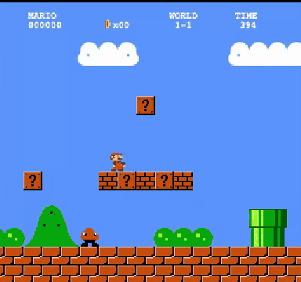
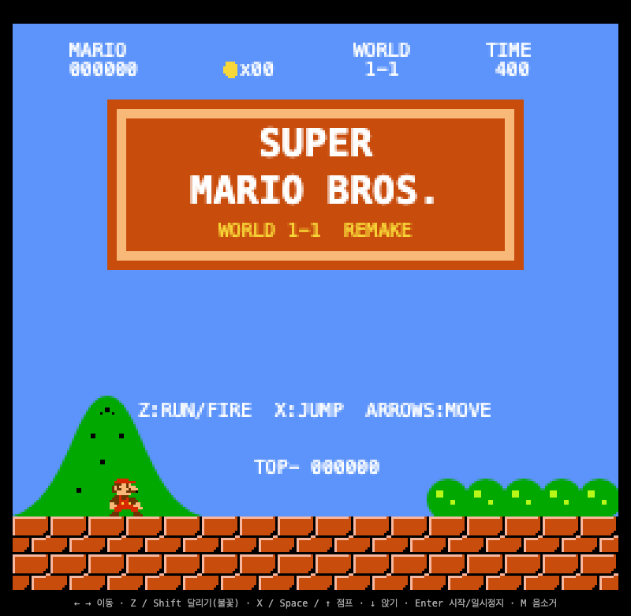
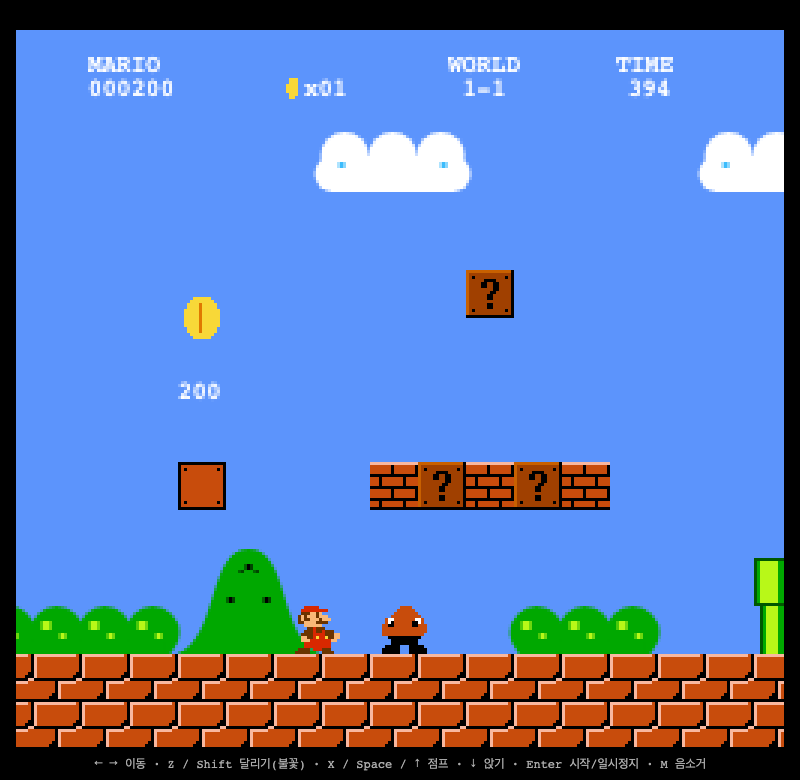

# 🍄 SUPER FABLE BROS. — World 1-1

### *One-shotted by **Claude Fable 5.1** — not 5. The point-one is the whole point.*

> **Super Mario Bros. World 1-1, remade in ONE single HTML file. Zero dependencies. Zero build step.**
> Character and enemy art is cut out of classic fan sprite rips (SML2 Mario,
> SMW Goomba/Koopa); tiles, items, and music are still synthesized from raw code.

<p align="center">
  <a href="https://inonono66.github.io/fable-5.1-mario/"><b>▶️ PLAY IT RIGHT NOW</b></a>
</p>

<p align="center">
  
</p>

<p align="center">
  
  
</p>

<p align="center">
  🎬 <a href="docs/full-run.mp4">Full no-death flagpole run (mp4, 🔊 sound on)</a> — played start-to-finish by a scripted autopilot, 22,500 pts, 3 lives intact.
  <br>The chiptune you hear is 100% WebAudio oscillators — there is no audio file anywhere in this repo.
</p>

<p align="center">
  
  
  
  
  
  
</p>

---

## What is this?

The entire World 1-1 experience — the level layout, physics, enemies, power-ups,
the iconic overworld theme — packed into a single `index.html` you can open by
double-clicking. No `npm install`. No `.mp3` files. Serve the folder (or open
the file) and the SML2/SMW rip frames in `assets/` load on top of the
procedural fallback art. Just open it.

**One-shotted by `claude-fable-5-1` — that's Fable 5.1, mind the minor version.**
The whole game was produced by the model in a single coding session — no human wrote
a line of it. If Fable 5 was the fairy tale, 5.1 is the one that ships playable games
in one take.

## Features

- 🗺️ **Faithful 1-1 layout** — pipes, pits, staircases, the multi-coin block, hidden 1-UP energy, flagpole & castle finish
- 🏃 **Real SMB-style physics** — run momentum, skid, variable-height jumps, crouching
- 🍄 **Full power-up chain** — Small → Super → Fire Mario (yes, you can throw fireballs), Starman invincibility, 1-UP mushrooms
- 👾 **Enemies** — Goombas and Koopa Troopas, with stompable + kickable shells and combo scoring
- 🎵 **Chiptune synth engine** — the overworld theme and all SFX (coin, stomp, fireball, flagpole fanfare, hurry-up speedup at 100s) generated live with the WebAudio API. Not a single audio file
- 🎨 **Hand-encoded pixel art** — every sprite is a string-encoded bitmap rendered to canvas, palette-swapped for Fire Mario and 1-UPs
- 📱 **Touch controls** — virtual D-pad + A/B buttons appear automatically on mobile
- ⏸️ Pause, mute, lives, score, coin counter, 400-second timer — the whole HUD

## Controls

| Action | Keys |
|---|---|
| Move | `←` `→` / `A` `D` |
| Jump | `X` / `Space` / `↑` |
| Run / Fireball | `Z` / `Shift` |
| Crouch | `↓` |
| Start / Pause | `Enter` |
| Mute | `M` |

On touch devices, on-screen buttons show up on their own.

## Run it

```sh
git clone https://github.com/INONONO66/fable-5.1-mario.git
open fable-5.1-mario/index.html   # that's it. that's the build system.
```

Or just play the hosted version: **https://inonono66.github.io/fable-5.1-mario/**

## How it fits in one file

| Subsystem | How |
|---|---|
| Rendering | 256×240 `<canvas>`, integer-scaled, `image-rendering: pixelated` |
| Sprites | ASCII bitmap strings → offscreen canvases at boot, palette-swap for variants (tiles, items); Mario/Goomba/Koopa/shell/fireball frames are cut from fan rips — see Art below |
| Audio | Tiny sequencer over `OscillatorNode`s — square/triangle waves, note tables in MIDI numbers |
| Level | Tile map built procedurally with helpers (`pipe(x,h)`, `stairs(...)`, `q(x,y,'mush')`) |
| Physics | Fixed-timestep loop, tile-based AABB collision, NES-flavored accel/friction constants |
| Spawns | Camera-trigger thresholds + patrol bounds per enemy (idea from jipham510, see References) |
| Collision | Swept last-position guards so fast bodies can't tunnel (idea from jipham510 `Tile_Collision`) |
| Background | Clouds on a 0.5× parallax layer (idea from CharlesStover's `mario.js` controller) |

## Art: SML2 Mario + SMW enemies

The first step of the Super Mario World migration: Mario (small / big /
fire), the fireball, Goomba, Koopa, and shell are now real ripped sprites —

- **Mario** — Super Mario Land 2: Six Golden Coins, Mister Man rip
- **Goomba** — Super Mario World, NES Boy rip (Yellow row)
- **Koopa + shell** — Super Mario World, ARMA rip (Green section)

Source sheets live in `assets/src/`; playable frames are cut out by
`tools/cut_sprites.py` (flood-fill background removal from the sheet's
orange/cyan/teal backing color, bounding-box extraction, transparent trim)
into `assets/cut/*.png` per `assets/manifest.json`:

```sh
python3 tools/cut_sprites.py preview assets/src/mario-5.png "#ff8040" /tmp/preview.png  # numbered boxes
python3 tools/cut_sprites.py cut assets/manifest.json assets                            # re-cut all frames
```

`index.html` loads the frames at boot and swaps them over the procedural
art; anything missing keeps its procedural fallback, so the game always
runs — even from `file://`. Full ripper credits: [`assets/CREDITS.md`](assets/CREDITS.md).

Still procedural (next migration steps): tiles, power-up items, Bunny Mario
(cape-equivalent), SML2 enemies/items, SMW mechanics (spin jump, etc.).

## References

Mechanics ideas ported (not code — the implementation above stays original,
single-file, zero-dependency) from these open-source Mario engines:

- **[CharlesStover/super-mario-world-js](https://github.com/CharlesStover/super-mario-world-js)** (JS, MIT-style college project) — redux-style reducer + `Sprite` model with split `collisionX`/`collisionY` handlers, bouncing-fireball model (`verticalVelocity` reset on ground contact), parallax background scrolling at `mario.x / 2`, timer-based enemy spawns. Its Python twin **[CharlesStover/super-mario-world-py](https://github.com/CharlesStover/super-mario-world-py)** documents the same controller/reducer/view architecture.
- **[jipham510/Super-Mario-World](https://github.com/jipham510/Super-Mario-World)** (vanilla JS + canvas) — OOP `GameObject` + composable behaviors (`AutoMove` patrol limits, `SpawnEnemies` camera triggers, `Stomp` bounce), `Tile_Collision` swept resolution using last-position guards (`getLastRight`/`getLastBottom`), lethal-shell kills-other-enemies logic with kicker i-frames, and JSON range-based level parsing. Our `trigger`/`x1`/`x2` spawn fields, swept guards in `moveX`/`moveY`, shell `noHurt` + kicker `invuln` window, and moving-shell lethality follow these designs.

## 🤖 Agent Trajectory

This game was generated end-to-end by **Claude Fable 5.1** (`claude-fable-5-1`). The
full agent session trajectory — every prompt, tool call, and edit, completely
unedited — is published on Hugging Face:

> 📦 **[INONONO/fable-5.1-mario-trajectory](https://huggingface.co/datasets/INONONO/fable-5.1-mario-trajectory)**
> — raw Claude Code session log (`trajectory.jsonl`, 95 model turns / 51 user events / ~1.1 MB).
> No human wrote a line of the game; the whole prompt→tool-call→edit loop is in there.

## License

Fan-made, non-commercial educational remake. Super Mario Bros. is a trademark of
Nintendo. All original code in this repo is MIT.
